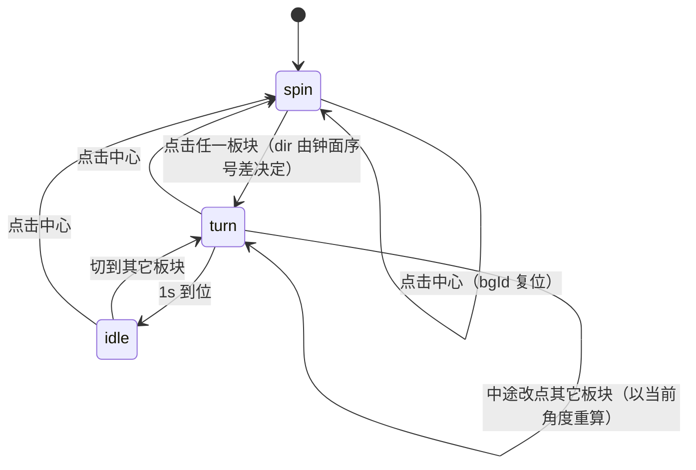

## 用户需求

把「切换板块时背景光带永远顺时针转半圈」改为「按钟面方向决定旋转方向」。

## 产品概述

把四个板块看成钟面：**喜好 12 点、项目 3 点、记忆 6 点、链接 9 点**。切换板块时，光带的旋转方向跟随钟面上从起点到终点的方向，让背景转动与用户点击的空间关系一致。

## 核心功能

- **顺一格**（如 项目 3 → 记忆 6、喜好 12 → 项目 3）：光带顺时针转 90°。
- **逆一格**（如 项目 3 → 喜好 12、记忆 6 → 链接 9）：光带逆时针转 90°。
- **正对面**（喜好 12 ↔ 记忆 6、链接 9 ↔ 项目 3）：一律顺时针转 180°。
- **中心 → 任意板块**：一律顺时针，转到该板块的档位（0° 或 90°）。
- **重复点击当前板块**：沿用现有「每次都有动作」的语义，给一记顺时针 180°。

## 视觉结果

在相邻板块间切换时，背景亮带会按点击的方向「顺/逆」旋转 90°，动作方向与手指在圆盘上移动的方向一致；上切下、左切右时则是一次完整的半圈回转。光带的尺寸、亮度、12°/s 自转、1s 转场时长均不变。


## 技术栈

沿用现有纯静态站点：HTML + CSS + 原生 ES6，无构建、无框架、无新增运行时依赖。仅修改 `index/script.js`。

验证用 Node + puppeteer-core 驱动本机 Edge（依赖已在 `%TEMP%\pptr`，按要求不删除），读 `bg.from` / `bg.to` 与 `getComputedStyle(#bgField).transform` 校验方向。

## 实现方案

### 核心策略

现有的 `bgTurnTo()` 只有「顺时针」一种语义：`Math.ceil((angle - want) / 180)` 永远向上取整，已经在档位上时再补 180°。

改为**两段判断**：
1. 用「上一次所处的板块」在钟面上的序号差算出方向（`step`）：`1` 顺一格、`2` 正对面、`3` 逆一格、`0` 同一格。
2. 把方向交给一个纯函数求目标角度：顺时针取 `want + 180k` 中**大于**当前角的最小值，逆时针取**小于**当前角的最大值；若正好落在档位上，再按方向多走 180°。

### 关键决策

1. **方向由「上一次的板块」决定，而不是由当前角度决定**
   光带是一条直线（180° 对称），任意时刻都满足两个档位；只看角度无法区分「从哪来」。因此新增 `bgId` 记录来源板块，`core` 记为 `'core'`。

2. **抽出一个纯函数 `bgTurnTarget(angle, want, dir)`**
   把「顺时针/逆时针求等价角 + 补半圈」从 `bgTurnTo` 中分离，`bgTurnTo` 只负责判定方向。副作用是重复点击（`step === 0`）自然落到「顺时针补半圈」，与现有行为一致。

3. **正对面与重复点击都走顺时针**
   `step === 2`（12↔6、3↔9）与 `step === 0`（同格）时的角度增量都必然是 ±180°/180°，按用户要求统一取顺时针。

4. **不改动 `bg.angle` 只累加不取模的约定**
   逆时针会让角度持续减小（可为负），`toFixed(2)` 与 `rotate()` 都能正确处理；一旦取模就会在归零那一帧反向回跳。

5. **不改缓动与时长**
   继续用 `animLoop` 里的 `easeInOutCubic` 与 `BG_TURN = 1.0`，正反转手感一致。

### 边界与可靠性

- **转场途中再点其它板块**：`bgTurnTo` 以当前 `bg.angle` 为起点重新计算，方向按新的 `bgId → 目标` 判定，不排队、不叠加（沿用现有行为）。
- **reduced-motion**：`animLoop` 的整段背景更新仍被 `!reduceMQ.matches` 挡住，激活该设置时亮带不参与任何旋转，行为与改动前一致。
- **切后台回来**：`dt` 已钳在 0.12s，角度不跳变。
- **性能**：不新增每帧计算，`bgTurnTarget` 只在点击时调用一次；`renderBg` 仍每帧只写一个 `transform`。

## 系统架构



数据流：扇区点击 → `select(id)` → `bgTurnTo(id)` 读 `BG_CLOCK[bgId]` 与 `BG_CLOCK[id]` 求 `step → dir` → `bgTurnTarget()` 得到 `bg.to` → 主循环按 `dt` 推进 `bg.angle` → `renderBg()`。

## 目录结构

```
d:/AAAmp/rlcyyg_modpack/index/
└── script.js   # [MODIFY] 四处：
                # 1) 常量区（BG_ANGLE 之后，约第 41 行）新增 BG_CLOCK 与 bgId；
                # 2) 第 169–172 行段首注释改写为「按钟面方向顺/逆时针」；
                # 3) 第 178–185 行 bgTurnTo 重写，并新增 bgTurnTarget；
                # 4) 第 1324–1326 行 select() 末尾：回中心时同时把 bgId 复位为 'core'。
```

不改 `style.css`、`index.html`、`index/test.html`、`index/失败的背景.md`。

## 关键代码结构

```js
/* 钟面序号：顺时针递增（喜好 12、项目 3、记忆 6、链接 9） */
const BG_CLOCK = { interests: 0, projects: 1, artists: 2, links: 3 };
let bgId = 'core';        /* 上一次进入的板块；中心为 'core' */

/* 沿指定方向走到 want 的下一个等价角（want + 180k）。
   dir = +1 顺时针（角度递增）、-1 逆时针（角度递减）；
   已经停在该档位时再走半圈，保证每次切换都有动作。 */
function bgTurnTarget(angle, want, dir) { /* 返回目标角度 */ }

function bgTurnTo(id) { /* 由 BG_CLOCK 差值得 step，step 3 → 逆时针，其余顺时针 */ }
```

## 各切换的预期增量

| 切换 | 钟面 | 角度 | step | 增量 |
| --- | --- | --- | --- | --- |
| 项目 → 记忆 | 3 → 6 | 0 → 90 | 1 | **+90** |
| 记忆 → 链接 | 6 → 9 | 90 → 0 | 1 | **+90** |
| 链接 → 喜好 | 9 → 12 | 0 → 90 | 1 | **+90** |
| 喜好 → 项目 | 12 → 3 | 90 → 0 | 1 | **+90** |
| 项目 → 喜好 | 3 → 12 | 0 → 90 | 3 | **−90** |
| 喜好 → 链接 | 12 → 9 | 90 → 0 | 3 | **−90** |
| 链接 → 记忆 | 9 → 6 | 0 → 90 | 3 | **−90** |
| 记忆 → 项目 | 6 → 3 | 90 → 0 | 3 | **−90** |
| 喜好 ↔ 记忆 | 12 ↔ 6 | 90 ↔ 90 | 2 | **+180** |
| 链接 ↔ 项目 | 9 ↔ 3 | 0 ↔ 0 | 2 | **+180** |
| 中心 → 任意 | core → x | 任意 → 0/90 | 1 | 顺时针 |
| 重复点击当前 | x → x | 同角 | 0 | **+180** |

## 验收方式

1. **静态**：`script.js` 出现 `BG_CLOCK`、`bgId`、`bgTurnTarget`；`bgTurnTo` 内不再是无条件 `Math.ceil` 单向取整；注释与新语义一致。
2. **运行时**（无头 Edge，每次点击后等 1.2s 读 `bg.from` / `bg.to`）：
   - 顺时针链 `projects → artists → links → interests → projects`，四次增量均为 **+90**；
   - 逆时针链 `projects → interests → links → artists → projects`，四次均为 **−90**；
   - `interests → artists`、`links → projects` 为 **+180**；
   - 中心 → 四个板块，`bg.to - bg.from` 均 **> 0**；
   - 连续两次点击同一板块，第二次仍为 **+180**；
   - 采样 `transform` 矩阵反算角度，确认转向与符号一致、无反向抖动，控制台无报错。
3. **视觉**：截两张 GIF 级别的连续截图（顺时针一格、逆时针一格），确认亮带转动方向与点击方向一致。
4. **临时文件**：按要求不删除验证脚本与截图，在汇报末尾列出完整路径。

