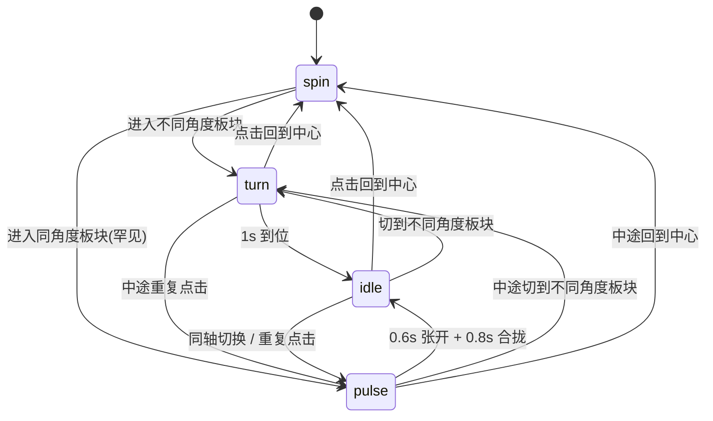

## 用户需求

在现有「四分区圆盘」网站的基础上，重做背景光带的表现，使其更安静、更冷、与四分区结构呼应；同时保留现有入场时序与全部前景内容。

## 产品概述

背景由「一条会呼吸、会整体旋转的亮带」改为「两条对称亮带」：中心态交叉成 X 并缓慢反向转动，进入板块时收拢成一条线，回到中心时自然掰开。整体色调冷一档，出现方式更克制。

## 核心功能

- **去除亮带呼吸**：背景不再整体明暗起伏，亮度恒定。
- **拉平亮带过渡**：亮带由「中心亮、两侧陡降」改为更宽更绵的过渡，转动与合拢时不再看出「带子有边」。
- **整体冷一档**：页面底色、亮带色标、文字光晕统一偏冷 2–3%；线条、边框、扇区填充等线稿仍保持纯白，保证锐度。
- **中心态双光带 X**：两条亮带分别呈 `\` 与 `/` 的 45° 与 135°，交叉成 X；`\` 逆时针、`/` 顺时针，各 3°/s。因此 X 不会整体旋转，而是原地缓慢开合：约 15 秒收成一条横线、30 秒回到 X、45 秒收成一条竖线，如此循环，X 始终出现在同一组 45°/135° 上。
- **进入板块即合拢**：从 X 出发，两条各走最短路径，1 秒内合拢成该板块的单条角度（横向板块为横线，纵向板块为竖线），到位后完全静止。若某条正好需要转 90°（正反路径等长），`\` 走逆时针、`/` 走顺时针。
- **板块之间切换**：不同轴时两条各转 90°，中途会短暂张开一次 X 再合拢到新角度；同轴切换（同角度板块）时播放「张开成 X 再合回去」的 1.4 秒动作（0.6 秒张开、0.8 秒合拢）。
- **重复点击当前板块**：每次都完整重放上述 1.4 秒动作，可连续触发，不会因重复点击而角度累积偏移。
- **回到中心**：不播放张开动画，直接恢复反向转动，由两条带自行慢慢掰开，约 15 秒重新形成 X。
- **重叠不叠色**：两条带重合时亮度与原先单条带完全一致，交叉点也不会出现更亮的过曝亮点。

## 视觉结果

首屏一出现，背景就是一枚完整的 45° 十字光带，随后极缓慢地开合；点入任一板块，两道斜光像剪刀一样收拢成一条水平或垂直的亮线，页面安静下来；在同角度的两个板块之间切换时，那条亮线会轻轻张开成 X 再合上，作为切换的回执；点回中心，亮线从中间慢慢裂成两条，重新长回十字。整体仍是纯灰阶骨架，只是比现在更冷、更绵、更有结构感，前景的圆盘、刻度环、文字与卡片不受影响。

## 边界与不变项

- 系统开启「减少动态效果」时，背景固定在 45°/135° 的静态 X，切板块直接跳到目标角度，无过渡。
- 合拢或脉冲进行中再次切换板块，以当前角度为起点重新计算，不排队、不叠加。
- 入场时序（2.4 秒总长、弧 0.45 秒起步、中心图 0.45 秒开始加载并 1.95 秒淡入）、四区块内容、卡片轮盘、移动端重排全部保持不变。

## 技术栈

- 纯静态站点：HTML + CSS + 原生 ES6，无构建、无框架、无新增依赖
- 动效：CSS `transform`（GPU 合成）+ 既有 rAF 主循环按 `dt` 推进角度
- 混合：`mix-blend-mode: lighten` 解决双带重叠亮度叠加问题
- 校验：Node + puppeteer-core 驱动本地 Edge 无头实例，读 `getComputedStyle` 矩阵反算角度

## 实现方案

### 核心策略

把「一个旋转的大渐变块」拆成「固定容器 + 两条同款渐变子层」，每层独立 `rotate()`；JS 从写一个角度改为写两个角度，并用一个四态状态机（`spin / turn / pulse / idle`）统一驱动所有切换场景。

### 关键决策与理由

1. **必须是两个独立图层，而不是单层双渐变**
`background-blend-mode` 只能让两层渐变共享同一个 `transform`，无法各自反向旋转。因此 `#bgField` 退化为定位容器，两条带是它的子元素，各自持有 `transform: rotate(Xdeg)`。

2. **用 `lighten` 而不是调透明度补偿**
两条带同色渐变，重合时若按普通 alpha 叠加会变亮（1−(1−a)²）。`lighten` 取每通道较大值，等价于「取较亮的那条」，重合处亮度恒等于单条带，且合拢途中两带扫过彼此时的交叠区也不过曝。容器加 `isolation: isolate`，把混合限制在背景层内部，不影响页面其它元素。
代价是可能影响合成路径（见性能）。

3. **角度用「最近等价角」而非强制顺时针半圈**
旧实现为保证每次都有动作，会强制多转 180°。双带场景下这会破坏「剪刀合拢」的对称性。改为对每条带独立求 `want + 180k` 中离当前最近的一个；恰好 90° 平局时按 `\` 逆时针、`/` 顺时针 定向。这样从 X 到 0° 是两条各 −45°/+45° 的对称收拢，从 X 到 90° 同理。

4. **脉冲使用绝对目标，保证可重复触发**
同角度切换/重复点击的目标写成「张开到 `want−45` / `want+45`，再收回 `want`」，而不是「在当前角基础上 ±45」。这样连续快速点击只会从当前位置重新走向同一组绝对角，不会逐次外扩漂移。

5. **回到中心不主动张开**
直接切到 `spin`，从当前合拢角开始 A 递减、B 递增，15 秒后自然重新垂直。省掉一段与常驻转动竞争速度的动画，也符合「更安静」的取向。

6. **状态判定依赖 `lastWant`，而不是几何位置**
`bgTurnTo(id)` 内比较「本次目标角度」与「上次进入的板块角度」：相同即触发脉冲（覆盖同轴切换与重复点击），不同则走 1 秒合拢；`bgToCore()` 把 `lastWant` 置空，保证从中心进入板块永远是合拢而非脉冲。

### 性能与可靠性

- `bgBands` 在启动时一次性取好，每帧只写两次 `style.transform`，不做 DOM 查询、不读布局属性。
- 板块态进入 `idle` 后完全停止写样式，零重绘。
- 两层各 150vmax 的合成层，显存约 2×18MB；`lighten` 可能使合成退回软件路径，属已知风险。实现后实测帧率，若确有问题再单独提兜底（本方案按要求不预置移动端降级）。
- `dt` 已由主循环钳在 0.12s，切后台回来不会产生角度跳跃。
- 角度只累加不取模，`toFixed(2)` 输出，长时间运行不会出现回跳。
- `prefers-reduced-motion` 下走独立分支：直接赋值目标角并置 `idle`，不进入任何动画态。

## 系统架构



数据流：扇区点击 → `select(id)` → `bgTurnTo(id)` / `bgToCore()` 写入 `bg.mode` 与目标角 → 主循环按 `dt` 推进 `bg.a`、`bg.b` → `renderBg()` 写两条 `transform`。

## 目录结构

```
d:/AAAmp/rlcyyg_modpack/
├── index.html                 # [MODIFY] 线上入口。第 9 行 theme-color 改 #0a0b10；第 26 行 #bgField 内补两个 .bg-band 子层并更新注释。
└── index/
    ├── test.html              # [MODIFY] 本地预览副本，与 index.html 做完全相同的两处修改（保持两份一致）。
    ├── style.css              # [MODIFY] 重写第 35–87 行背景区块：#bgField 改为定位容器（inset:0、overflow:hidden、底色 #0a0b10、isolation:isolate），新增 .bg-band（150vmax、对称冷灰渐变、lighten、will-change）；删除 #bgField 的 bgBreath 动画与 @keyframes bgBreath；body 底色改 #0a0b10；第 232/250/311/319/331/382/1074/1179/1763/1777 行 10 处 text-shadow 的白改 rgba(226,236,255,同 α)。
    └── script.js              # [MODIFY] 第 36–42 行常量改为 BG_X_A/BG_X_B/BG_SPIN=3/BG_TURN/BG_PULSE_OPEN=.6/BG_PULSE_CLOSE=.8；第 170–186 行改为双带状态对象、renderBg 写两层、easeInOut 与 bgTarget 工具、bgTurnTo 重写、新增 bgToCore；第 234–247 行主循环背景分支扩展为 spin/turn/pulse 三态；第 1325–1327 行 select 末尾改为调用 bgToCore/bgTurnTo。启动段 renderBg() 保留。
```

## 关键代码结构

```js
const bg = {
  a: BG_X_A, b: BG_X_B,            // 两条带当前角度；a 递减(逆时针)、b 递增(顺时针)
  mode: 'spin',                    // spin | turn | pulse | idle
  fromA: 0, fromB: 0, toA: 0, toB: 0,
  openA: 0, openB: 0,              // pulse 张开的绝对目标
  closeA: 0, closeB: 0,            // pulse 收拢的绝对目标
  t: 0, dur: 0,
  lastWant: null,                  // 上次进入板块的角度；core 为 null
};
function renderBg(): void;                                  // 写两条 transform
function bgTarget(cur, want, ccw): number;                  // 最近等价角 + 90° 平局定向
function bgTurnTo(id): void;                                // 合拢 / 脉冲
function bgToCore(): void;                                  // 恢复反向自转
```

## 实施要点

- 局部替换，不重写整个文件；数值改动必须同步上方注释，避免注释与代码脱节。
- `BG_BREATH` 常量与 `#bgField` 的 `animation` 一并删除，不留死代码。
- 两处 HTML 的 `#bgField` 与 `theme-color` 必须完全一致，改完用一次搜索确认。
- 只替换 10 处 `text-shadow` 里的白色，其它 `rgba(255,255,255,…)`（边框、描边、扇区、卡片、徽标）一律不动。

## 验收方式

1. 静态检查：`#bgField` 无 `animation`、`bgBreath` 关键字不存在、两份 HTML 各有 2 个 `.bg-band`、`theme-color` 为 `#0a0b10`、10 处光晕为 `rgba(226, 236, 255, …)`。
2. 运行时（无头浏览器读两条带 `transform` 矩阵反算角度）：中心态 3 秒内 A 递减、B 递增各约 3°/s；点板块 1 秒内角度差收敛到 0 且角度等于 0 或 90；同轴切换 0.6 秒时角度差约 90°、1.4 秒回到 0；重复点击可再次出现 90°；回中心后角度差以约 6°/s 增大。
3. 视觉核对：截图确认 X 交叉处无过曝亮点、合拢后亮度与单条带一致、文字光晕偏冷、背景无明暗呼吸。

## 设计定位

延续现有「冷灰单色 + 技术制图」的语汇：背景不是装饰图案，而是圆盘结构的延伸。四分区由 45°/135° 两条斜线切分，因此中心态的 X 正好压在四个扇区的分界上，背景骨架与环内结构重合。

本次只重做背景层，排版、字体、前景元素全部保持现状。

## 背景与光带

- 底色 `#0a0b10`（略偏冷的近黑），亮带峰值 `#333440`，过渡色标 `#2b2c38`、`#14151d`，全部低饱和冷灰，蓝相约占 2–3%，肉眼不认为是彩色，只感到「比现在更冷」。
- 两条同款对称渐变层，边缘到中心再到边缘完全镜像；色标位置 0/24/40/50/60/76/100，过渡段占宽 20%，转动与合拢时看不到硬边。
- 两层以 lighten 叠加：合拢成一条时亮度与单带一致，交叉点不过曝。

## 运动语言

- 中心态：`\` 逆时针、`/` 顺时针，各 3°/s。不是整体旋转，而是原地缓慢开合，像光圈；15 秒收拢、30 秒复圆。
- 进入板块：1 秒内对称收拢成一条水平或垂直亮线，动作像剪刀合上，收束感强于旧版的整体回转。
- 同轴切换：1.4 秒内张开 45° 再合回，是一次轻量「回执」，不改变最终状态。
- 回到中心：不主动张开，由两条带自转慢慢裂开，动作被拉长到 15 秒，几乎察觉不到起点。

## 动效克制原则

- 全站常驻动画只剩三条：光带开合、刻度环 60 秒自转、头像 8 秒光晕。
- 背景不再做亮度呼吸，避免与头像光晕在同一感知通道上叠加。
- 所有切换动作只发生一次、方向明确，不做循环脉冲。

## 响应式

桌面与移动端共用同一套背景与速度；移动端沿用现有重排，不做背景降级。